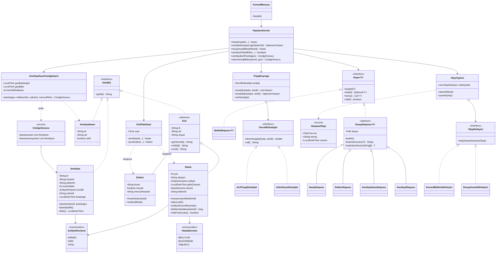

# Hastane Planlama Sistemi

Konsol üzerinden çalışan, verileri dosyada kalıcı olarak saklayan bir hastane planlama uygulaması.
Nesneye Yönelik Programlama dersi dönem projesi olarak hazırlanmıştır.


## Ne yapar?

| Modül | Açıklama |
|---|---|
| **Hasta önceliklendirme (triyaj)** | Gelen hastalar kırmızı, sarı ve yeşil aciliyetle kaydedilir. Bekleme kuyruğu aciliyet, bekleme süresi ve risk taşıyan yaş grubuna göre sıralanır. |
| **Doktor çizelgeleme** | Müsait doktor sıradaki en öncelikli hastayı çağırır. Bir doktor aynı anda tek hastayla ilgilenir ve muayene bitince yeniden müsait olur. |
| **Ameliyathane çizelgeleme** | Ameliyat talepleri, salon ve doktor çakışması olmadan, aralarda temizlik süresi bırakılarak mesai saatlerine (08:00-18:00) yerleştirilir. |
| **Arıza durumunda plan güncelleme** | Bir salon arızalanınca o günün planı kalan salonlara, öncelik sırası korunarak yeniden dağıtılır. |
| **Bildirim ve günlük** | Kritik hasta, salon arızası gibi olaylar konsolda uyarı olarak gösterilir ve `data/olay_gunlugu.txt` dosyasına yazılır. |

## Çalıştırma

Gereksinimler: **Java 17 veya üstü** ve **Maven** (IntelliJ IDEA'da Maven hazır gelir).

1. IntelliJ IDEA'da `File → Open` ile proje klasörünü (içinde `pom.xml` olan klasörü) açın.
2. `src/main/java/com/hastane/Main.java` dosyasını açıp ▶ düğmesine basın.
3. Testler için `src/test/java` klasörüne sağ tıklayıp **Run 'All Tests'** seçeneğini kullanın.

Komut satırından testler: `mvn test`

İlk açılışta menüden **15) Örnek veri yükle** seçilirse 3 doktor, 2 salon, 4 hasta ve 4 ameliyat talebi hazır gelir.

## Veri saklama

Veriler uygulamanın çalıştığı dizindeki `data/` klasöründe, `;` ile ayrılmış metin dosyalarında tutulur.
Uygulama kapatılıp açıldığında veriler korunur.

| Dosya | İçerik |
|---|---|
| `hastalar.txt` | id;ad;soyad;yaş;şikâyet;aciliyet;gelişZamanı;durum;doktorId |
| `doktorlar.txt` | id;ad;soyad;branş;müsait;mevcutHastaId |
| `salonlar.txt` | id;ad;aktif |
| `ameliyatlar.txt` | id;hastaId;doktorId;işlem;süre;öncelik;salonId;başlangıç |
| `olay_gunlugu.txt` | Tüm olayların zaman damgalı kaydı |

## Paket yapısı

```
com.hastane
├── Main                      → nesneleri oluşturup birbirine bağlar
├── model      → Kimlikli, Kisi (abstract), Hasta, Doktor, Ameliyathane, Ameliyat, AciliyetSeviyesi, HastaDurumu
├── oncelik    → OncelikStratejisi, AcilTriyajStratejisi, GelisSirasiStratejisi, TriyajKuyrugu
├── cizelge    → AmeliyathaneCizelgeleyici, CizelgeSonucu
├── depo       → Depo<T>, DosyaDeposu<T> (abstract), BellekDeposu<T>, HastaDeposu, DoktorDeposu, AmeliyathaneDeposu, AmeliyatDeposu
├── olay       → OlayDinleyici, OlayYayinci, HastaneOlayi, OlayTuru, KonsolBildirimDinleyici, DosyaGunlukDinleyici
├── fabrika    → KisiFabrikasi, KimlikUretici
├── servis     → HastaneServisi
└── ui         → KonsolMenusu
```
Toplam 30'dan fazla sınıf, arayüz ve enum vardır.

## Nesneye yönelik programlama ilkeleri

| İlke | Projede nerede? |
|---|---|
| **Sınıf / nesne** | Hasta, Doktor, Ameliyat, Ameliyathane gibi gerçek dünya varlıkları |
| **Kalıtım** | `Kisi → Hasta, Doktor` ve `DosyaDeposu → HastaDeposu, DoktorDeposu, …` |
| **Soyutlama** | `Kisi` ve `DosyaDeposu` soyut sınıflar; `Depo`, `OncelikStratejisi`, `OlayDinleyici` arayüzler |
| **Çok biçimlilik** | `ozet()` ve `rolAdi()` metotları Hasta ve Doktor'da ezilir; `tumKisiler()` listesi `Kisi` tipinde tutulur. `OncelikStratejisi` arayüzünün iki farklı uygulaması aynı kuyrukla kullanılır. |
| **Kapsülleme** | Tüm alanlar `private`. Durum değişiklikleri kurallı metotlarla yapılır (`muayeneyeAl`, `taburcuEt`); geçersiz geçişlerde istisna fırlatılır. |

## SOLID prensipleri

| Prensip | Uygulama |
|---|---|
| **S** – Tek sorumluluk | `KonsolMenusu` yalnızca girdi/çıktı, `HastaneServisi` iş kuralları, `DosyaDeposu` dosya işlemleri, `AmeliyathaneCizelgeleyici` yalnızca çizelgeleme yapar. |
| **O** – Açık/kapalı | Yeni bir sıralama kuralı eklemek için `OncelikStratejisi` arayüzünü uygulayan yeni bir sınıf yazmak yeterlidir; kuyruk kodu değişmez. Yeni bildirim türleri için de `OlayDinleyici` uygulanır. |
| **L** – Liskov yerine geçme | `BellekDeposu` ve `DosyaDeposu` alt sınıfları `Depo` yerine sorunsuz kullanılır. Testlerde dosya deposu yerine bellek deposu verilir. |
| **I** – Arayüz ayrımı | Küçük ve odaklı arayüzler: `Kimlikli` (tek metot), `OlayDinleyici` (tek metot), `OncelikStratejisi` (iki metot). |
| **D** – Bağımlılığın tersine çevrilmesi | `HastaneServisi` somut sınıflara değil `Depo<T>` arayüzüne ve `TriyajKuyrugu` soyutlamasına bağlıdır. Somut nesneler `Main` içinde oluşturulup servise verilir. |

## Tasarım kalıpları

1. **Strategy:** `OncelikStratejisi` → `AcilTriyajStratejisi` ve `GelisSirasiStratejisi`. Önceliklendirme kuralı çalışma anında menüden (6) değiştirilebilir.
2. **Observer:** `OlayYayinci` (subject) ile `KonsolBildirimDinleyici` ve `DosyaGunlukDinleyici` (observer). Kritik hasta geldiğinde veya salon arızalandığında dinleyiciler haberdar edilir.
3. **Factory:** `KisiFabrikasi`, yeni hasta ve doktor nesnelerini doğru başlangıç değerleriyle oluşturur (geliş zamanı, "bekliyor" durumu, müsaitlik).
4. **Repository:** `Depo<T>` arayüzü, verinin nerede saklandığını servisten gizler.
5. **Template Method:** `DosyaDeposu` okuma/yazma iskeletini tanımlar; alt sınıflar yalnızca `satiraDonustur` ve `satirdanOlustur` adımlarını doldurur.

## Algoritmalar

### 1. Öncelik kuyruğu ile triyaj (`TriyajKuyrugu`, `AcilTriyajStratejisi`)
```
skor = aciliyet puanı × 100            (Kırmızı=3, Sarı=2, Yeşil=1)
     + min(bekleme dk, 120) × 0,5      (yaşlanma / aging: bekleyen hasta yavaşça öne geçer)
     + 15                              (65 yaş üstü veya 5 yaş altı ise)
```
Bekleme ve yaş katkısı en fazla 75 puan olduğu için bir üst renk her zaman önce çağrılır.
Aynı renkteki hastalar arasında ise uzun bekleyen ve risk grubundaki hasta öne geçer.
Hastalar `PriorityQueue` (ikili yığın) yapısına konup sırayla çekilir. Karmaşıklık O(n log n).

### 2. Açgözlü (greedy) çakışmasız ameliyathane çizelgeleme (`AmeliyathaneCizelgeleyici`)
1. Ameliyatlar önce önceliğe, sonra süreye göre (uzun olan önce) sıralanır.
2. Her ameliyat için tüm aktif salonlarda en erken boş başlangıç saati aranır. Aday saatler günün başı ile o salondaki ve o doktordaki ameliyatların bitiş anlarıdır.
3. Üç koşul kontrol edilir: salonda çakışma olmamalı (arada 30 dk temizlik), doktor aynı anda başka ameliyatta olmamalı, ameliyat mesai bitişini (18:00) aşmamalı.
4. En erken uygun salon seçilir. Hiçbir salona sığmayan ameliyat "planlanamayanlar" listesine yazılır.

## Birim testleri (16 test, JUnit 5)

| Test sınıfı | Ne test ediliyor? |
|---|---|
| `OncelikStratejisiTest` (4) | Kırmızının her zaman önde olması, bekleme süresinin önceliği artırması, yaş puanı, strateji değişimi |
| `TriyajKuyruguTest` (2) | Kuyruğa yalnızca bekleyen hastaların girmesi ve doğru sıralama, boş kuyruk |
| `AmeliyathaneCizelgeleyiciTest` (4) | Salon çakışması ve temizlik süresi, doktor çakışması, acil ameliyatın ilk saate yerleşmesi, mesaiye sığmama ve pasif salon |
| `HastaneServisiTest` (4) | Hasta çağırma ve muayene akışı, Observer bildirimi, arızada yeniden planlama, geçersiz işlemlerin reddi |
| `DosyaDeposuTest` (2) | Dosyaya kaydedip yeniden okuma (kalıcılık), silme ve kimlik üretimi |

## UML sınıf diyagramı


